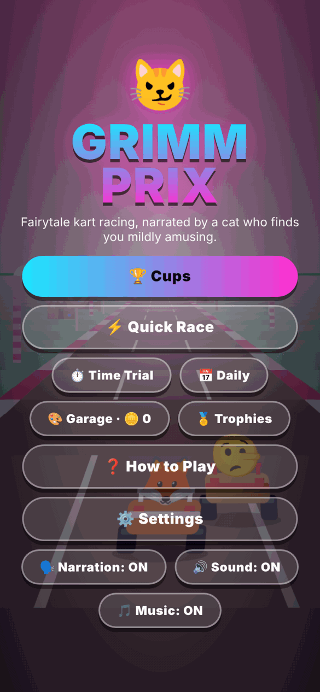
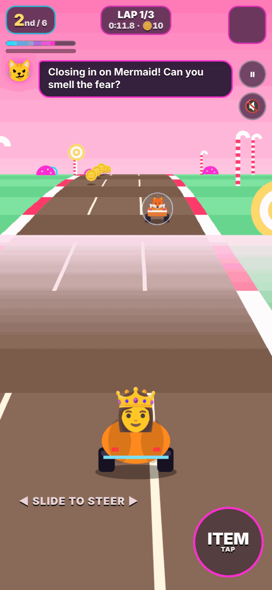
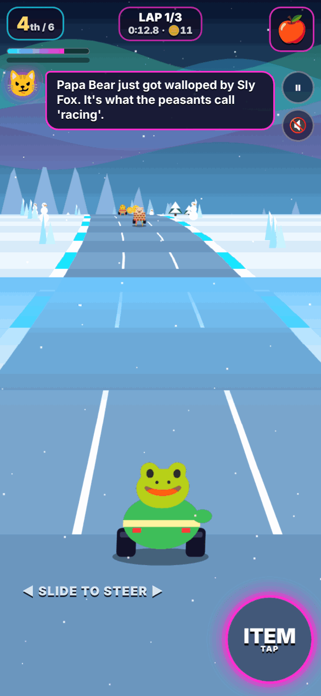
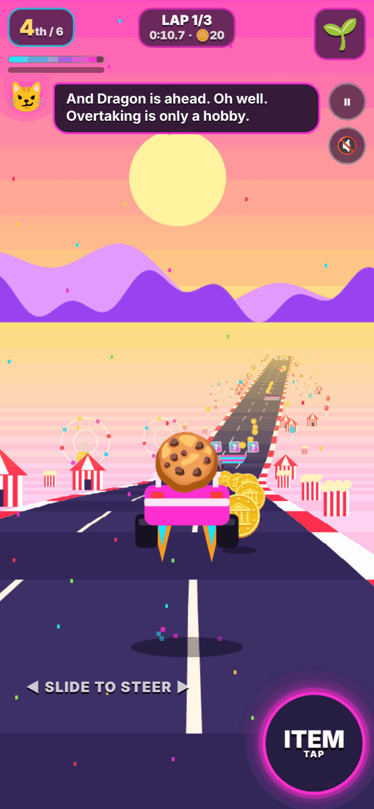
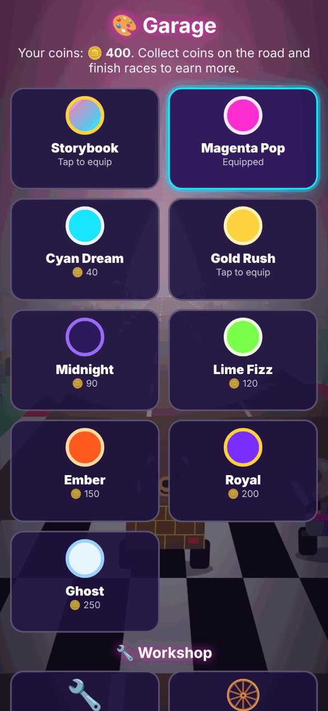

# 😼 Grimm Prix

**A fairytale kart racer for your phone, narrated by a very smug Cheshire Cat.**

Grimm Prix is a complete, single-file kart racing game. You pick from 15 storybook racers (the Gingerbread Man, Cinderella, the Big Bad Wolf, the Three Pigs, Alice, the Frog Prince, Papa Bear, the Dragon, the Sly Fox, the Little Mermaid, Pinocchio, the Bridge Troll, the Genie, Puss in Boots and Rumpelstiltskin), each with different stats, and race through 16 storybook tracks, throwing poison apples and rubber chickens at each other while the Cheshire Cat comments on everything you do, mostly unkindly.

There is nothing to install and no build step. It is one `index.html` file (about 160 KB) that runs in any modern mobile or desktop browser, and it is built to be hosted for free on GitHub Pages.

<p align="center">
  
  
  
  
  
</p>

---

## Contents

- [Quick start](#quick-start)
- [Deploy to GitHub Pages](#deploy-to-github-pages)
- [How to play](#how-to-play)
- [Game modes](#game-modes)
- [The racers](#the-racers)
- [Items](#items)
- [Tracks and cups](#tracks-and-cups)
- [Progression: coins, garage, workshop, trophies](#progression-coins-garage-workshop-trophies)
- [Shareable ghosts](#shareable-ghosts)
- [The Cheshire Cat](#the-cheshire-cat)
- [Settings](#settings)
- [Saved data](#saved-data)
- [Technical notes](#technical-notes)
- [Browser support](#browser-support)
- [Known limitations](#known-limitations)
- [Repository layout](#repository-layout)
- [Credits and legal](#credits-and-legal)

---

## Quick start

**Play locally:** download `index.html` and open it in a browser. That is all.

**Play on your phone:** host it (see below), open the link, and optionally use your browser's "Add to Home Screen". The game is portrait-first and also works in landscape.

On a phone the first tap anywhere starts audio (browsers require a tap before sound can play).

## Deploy to GitHub Pages

1. Create a new repository on GitHub (for example `grimm-prix`).
2. Upload everything in this folder to the repository root, so that `index.html` sits at the top level. The empty `.nojekyll` file tells GitHub Pages not to process the site.
3. In the repository go to **Settings → Pages**. Under **Build and deployment**, set **Source** to **Deploy from a branch**, choose the `main` branch and the `/ (root)` folder, then **Save**.
4. After a minute or two the game is live at `https://<your-username>.github.io/<repository-name>/`.

Command-line version:

```bash
git init
git add .
git commit -m "Grimm Prix 1.0.0"
git branch -M main
git remote add origin https://github.com/<your-username>/grimm-prix.git
git push -u origin main
```

Hosting matters for one feature: [shared ghost links](#shareable-ghosts) are web links, so they only make sense once the game has a public address.

---

## How to play

You race 3 laps against 5 AI karts chosen at random from the roster. Your kart accelerates by itself; you steer, drift and use items.

### Touch controls (default: slide steering)

| Action | How |
|---|---|
| Steer | Put your **left thumb anywhere on the left half** of the screen and slide. Further from where you touched means a sharper turn. The control follows your thumb, so you do not need to hit a fixed spot. |
| Use item | **Tap anywhere on the right half**, or tap the round **ITEM** button. |
| Drift | Automatic by default: lean hard into a big curve and the kart drifts. Straighten out to release the boost. |
| Pause | The **⏸** button, top right. |

A hint is shown on screen for your first races.

**Buttons scheme:** if you prefer a classic layout, switch **Steering** to **BUTTONS** in Settings. You then get left, right, drift and item buttons, and (with Auto-Drift off) you hold DRIFT in a corner and let go for the boost.

### Keyboard

| Key | Action |
|---|---|
| ← → or A / D | Steer |
| Shift or Z | Drift |
| Space, X or ↑ | Use item |
| P or Esc | Pause |

### Drifting and boosts

Holding a drift builds a charge shown by the bar under the lap counter. Sparks turn **white → cyan → magenta**.

- **Cyan sparks** (about 0.7 s of drift): short boost on release.
- **Magenta sparks** (about 1.5 s of drift): longer boost on release.

With **Auto-Drift** on, the game starts a drift for you when you steer hard through a big curve. Releasing (straightening out) gives the boost. Turn it off in Settings for manual control.

### Boost pads and item boxes

- **Cyan and magenta strips** on the road are boost pads. On tracks marked with a jump (see the track table), a pad also launches you into the air, which lets you fly over road hazards.
- **Rainbow "?" boxes** come in rows of three. Drive through one to roll an item. Boxes respawn after a few seconds.
- You can only hold one item. Rolls are weighted by position: the further back you are, the more helpful the item.

### Hazards

- **Off the road:** the grass slows you hard, and hitting roadside scenery bonks you.
- **Spin-outs:** hits from items spin you and knock your speed down, followed by a short invulnerable window so you cannot be chain-hit.
- **Wind:** on windy tracks a banner warns you, then a gust pushes everyone sideways for a few seconds. Heavier karts resist it a little.
- **Mud and sand patches:** drive through and your top speed roughly halves (boosting helps). You can steer around them.
- **Ice:** steering lags behind your thumb and curves pull harder, so turn early and gently.
- **Road hazards:** thorns, rats, fire, crabs, scorpions and rocks sit permanently on the road on some tracks. They spin you out when you hit them. The AI karts steer around them, so should you.

---

## Game modes

| Mode | What it is |
|---|---|
| **Cups** | Four races per cup. Points per race: 15, 12, 10, 8, 6, 4 for 1st to 6th. Highest total after four races wins the cup. Cups unlock in order. |
| **Quick Race** | One race on any of the 16 tracks. |
| **Time Trial** | Just you, no rivals and no item boxes. Race a translucent ghost of your best run on the track. Lap times and records are shown at the end. |
| **2-Player Duel** | Pass-the-phone Time Trial. Switch on **2-Player Duel** on the Time Trial track list. Player 1 sets a time, you hand over the phone, Player 2 tries to beat it. Exact ties are called a dead heat. |
| **Daily Challenge** | One fixed track per day, sometimes mirrored, with a twist: *Classic*, *No Items*, *Spiky Road* or *Gold Rush* (double coins). Finish in the top 3 to complete it. Reward: 50 coins plus 25 per streak day (streak bonus caps at 5 days). Everyone gets the same challenge on the same date. |
| **Mirror Mode** | A Settings toggle that flips every track left-to-right. Mirrored tracks keep their own best times and ghosts. |

### Competition setting

In **Settings → Competition**:

| Setting | Effect |
|---|---|
| **Relaxed** | Slowest AI, softest catch-up, rarest item use. |
| **Normal** (default) | A fair race you can win with decent driving. |
| **Racer** | Fastest AI and stronger catch-up. |

AI karts get slightly faster in later cups. A light rubber-band keeps races close without punishing you for driving well.

---

## The racers

| Racer | Vehicle | Speed | Accel | Turning | Weight | Notes |
|---|---|:-:|:-:|:-:|:-:|---|
| 🍪 **Gingerbread Man** | Cookie-Cutter Dragster | 3 | 5 | 4 | 1 | Quickest off the line, easily shoved around. |
| 👸 **Cinderella** | Pumpkin Carriage | 4 | 3 | 5 | 2 | Turns best of the original cast, drifts like a dream. |
| 🐺 **Big Bad Wolf** | Huff & Puff Hot Rod | 5 | 3 | 2 | 4 | Huge top speed, poor in corners. |
| 🐷 **Three Pigs** (The Three Little Pigs) | Brick Truck | 2 | 3 | 3 | 5 | Slow but heavy, and recovers faster from a spin-out. |
| 👧 **Alice** | Rolling Teapot | 3 | 4 | 5 | 2 | Nimble and quick to accelerate. |
| 🐸 **Frog Prince** | Lily Pad Hovercraft | 3 | 4 | 5 | 1 | Featherweight with top-tier grip. Great in tight tracks. |
| 🐻 **Papa Bear** | Porridge Pot Cart | 3 | 2 | 3 | 5 | A steady, very heavy bruiser that barges others aside. |
| 🐲 **Dragon** | Fire Wagon | 5 | 2 | 2 | 5 | Top-speed monster that barely turns or accelerates. |
| 🦊 **Sly Fox** | Getaway Gig | 4 | 4 | 3 | 2 | Strong all-rounder with a fast top end. |
| 🧜 **Mermaid** (The Little Mermaid) | Shell Speedboat | 2 | 4 | 5 | 1 | The best drifter in the game, short on top speed. |
| 🤥 **Pinocchio** | Wooden Soapbox | 2 | 5 | 3 | 1 | Explosive acceleration, low speed, very light. |
| 🧌 **Bridge Troll** | Bridge Bruiser | 4 | 1 | 2 | 5 | Slowest off the line, then a heavy, fast freight train. |
| 🧞 **Genie** | Magic Carpet Racer | 4 | 3 | 4 | 1 | Fast and agile but easily bumped about. |
| 🐈 **Puss in Boots** | Boot Buggy | 5 | 3 | 3 | 2 | Highest top speed with decent handling. |
| 🧝 **Rumpel** (Rumpelstiltskin) | Spinning-Wheel Special | 3 | 5 | 2 | 3 | Rapid acceleration, wide turning circle. |

Stats run 1 to 5. Weight decides who wins when karts bump and how much wind pushes you. Every race has 6 karts: you plus **5 opponents drawn at random from the other 14**. In a cup the same 5 opponents stay with you for all four races so the standings make sense, and in the Daily Challenge everyone gets the same opponents that day.

---

## Items

| Item | What it does |
|---|---|
| 🍎 **Poison Apple** | Dropped behind you. Whoever drives over it spins out. Disappears after a while. |
| 🐔 **Rubber Chicken** | Thrown straight ahead, wobbling. Spins the first kart it hits. |
| 👠 **Glass Slipper** | Homes in on the kart directly ahead of you. |
| 🍞 **Breadcrumb Boost** | A burst of speed. |
| 🪞 **Magic Mirror** | A shield that blocks the next hit (lasts about 10 seconds). |
| 🌱 **Beanstalk Sprout** | Launches you into the air with a boost and brief invulnerability, so you sail over everything. |

---

## Tracks and cups

Each cup has four tracks. **Wicked**, **Storybook** and **Enchanted** unlock when you finish the cup before them (any finishing place). Quick Race, Time Trial and the Daily Challenge give access to all 16 tracks at once.

### 🏆 Grimm Cup (unlocked from the start)

| Track | Notes |
|---|---|
| 🍬 **Gingerbread Village** | Gentle curves and hills. A sweet, easy introduction. |
| 🐺 **Wolf's Woods** | Dark twisty forest with **wind gusts**. |
| 🫖 **Croquet Grounds** | Wonderland lawn with big hills. Boost pads launch you (**jumps**). |
| 🕛 **Midnight Palace** | Golden dusk that turns into **purple night** on lap 2. |

### 👑 Wicked Cup

| Track | Notes |
|---|---|
| 🌱 **Beanstalk Climb** | Cloud-top road with steep hills. **Jump** pads. |
| 🐸 **Witch's Swamp** | Foggy bog with **mud patches**. |
| ❄️ **Snow Queen Glacier** | **Icy steering**, aurora sky, falling snow. |
| 🌹 **Thornwood** | **Thorn bushes** on the road, petals in the air. |

### 📖 Storybook Cup

| Track | Notes |
|---|---|
| 🐀 **Hamelin Town** | Dusk town with **rats** on the road. |
| 🧜 **Mermaid Lagoon** | Boardwalk over a lagoon, **shallow-water patches** slow you. |
| 💇 **Rapunzel's Tower** | Huge hills, **jumps** and **wind gusts**. |
| 🐉 **Dragon's Keep** | Volcano lair with **fire** on the road and rising embers. |

### 🔮 Enchanted Cup

| Track | Notes |
|---|---|
| 🎡 **Pinocchio's Funfair** | **16 boost pads**, jumps and falling confetti. |
| 🦜 **Neverland Cove** | Moonlit pirate cove, **wind** and **crabs**. |
| 🧞 **Sultan's Bazaar** | Dunes and lanterns, **sand patches** and **scorpions**. |
| 🪨 **Troll Mountain** | Big hills, **wind**, snow and **boulders**. |

Every track has its own palette, scenery, parallax background and Cheshire Cat commentary. Best times are saved per track (and per mirrored track).

---

## Progression: coins, garage, workshop, trophies

### Coins 🪙

Gold coins sit in short lines around every track and respawn each lap. You also earn a finishing bonus after each race:

| Result | Bonus |
|---|---|
| 1st / 2nd / 3rd / 4th / 5th / 6th | 30 / 20 / 12 / 8 / 5 / 5 |
| Time Trial | 5, plus 25 for beating your previous record |

### 🎨 Garage

Spend coins on kart paint. The paint you equip is used in every mode and shows on your ghost.

| Paint | Cost |
|---|---|
| Storybook (default) | free |
| Magenta Pop, Cyan Dream | 40 |
| Gold Rush, Midnight | 90 |
| Lime Fizz | 120 |
| Ember | 150 |
| Royal | 200 |
| Ghost | 250 |

### 🔧 Workshop

Three upgrades with three levels each, costing 60, 140 and 260 coins per level. They affect your kart in every mode.

| Upgrade | Per level |
|---|---|
| **Engine Tune** | +1.2% top speed, +4% acceleration |
| **Grip Tires** | +4% steering |
| **Coin Magnet** | Wider coin pickup |

### 🏅 Trophies

18 trophies, each with a coin reward. The Trophies page also shows your race, win and coin totals.

| Trophy | How to earn it | Reward |
|---|---|:-:|
| First Win | Win any race | 30 |
| Cup Champion | Win a cup | 80 |
| Drift Master | 10 drift boosts in one race | 50 |
| Clean Sweep | Win without spinning out | 60 |
| Pacifist | Win without using an item | 60 |
| Sharpshooter | Hit rivals 4 times in one race | 50 |
| Coin Collector | Collect 300 coins in total | 50 |
| Ghost Buster | Beat your own ghost | 50 |
| Ghost Hunter | Beat a friend's shared ghost | 60 |
| Globetrotter | Win on 6 different tracks | 100 |
| Wicked | Unlock the Wicked Cup | 40 |
| Storyteller | Unlock the Storybook Cup | 60 |
| Enchanted | Unlock the Enchanted Cup | 80 |
| Mirror Image | Win a race in Mirror Mode | 60 |
| Daily Devotion | Complete 3 daily challenges | 80 |
| Tuned Up | Max out an upgrade | 60 |
| Duelist | Finish a 2-player Time Trial duel | 40 |
| Big Spender | Own 5 paints | 50 |

---

## Shareable ghosts

Every Time Trial records your best run on each track. You can send that run to a friend, who races it alongside their own best.

**To share:** finish a Time Trial and tap **📤 Share my ghost**. You get a link (around 2,000 characters). On phones that support it, **Share…** opens the normal share sheet; otherwise **Copy link** puts it on your clipboard.

**To race a friend's ghost:**
- Open the link. The game imports the ghost on load and shows the track, racer and time, then **Race it ▶** starts a Time Trial on that track.
- Or on the Time Trial track list tap **📥 Import a friend's ghost** and paste the link or the code (the part starting `GP2.`).

The rival ghost appears as a see-through kart in the friend's racer and paint, tagged **RIVAL**. Your own best ghost runs alongside it. At the end the results tell you who won and by how much, and beating a rival unlocks the Ghost Hunter trophy. If the shared run was on a mirrored track, importing switches Mirror Mode to match for that session.

How it works: the run is a list of road position and lane samples taken every tenth of a second, compressed and encoded as text inside the link. There is no server, so nothing is uploaded anywhere. Ghost codes are lightly validated for shape and sanity, not for authenticity, so a determined person could craft a fake time. Treat them as friendly rivalry, not a leaderboard.

---

## The Cheshire Cat

Your announcer is a Cheshire Cat who reacts to the race as it happens. He has **450+ lines** across 100+ situations, including:

- starting grid, "GO", lap changes, final lap, and finishing in each position
- overtakes and being overtaken, taking and losing the lead, closing in on the kart ahead, being miles ahead or miles behind
- every item you pick up, use, or get hit by, and every hazard type
- boosts, drift boosts, jumps, going off road, hitting scenery
- track-specific chatter (every track has its own idle lines), rival-specific banter when a racer is next to you, and a different intro for the racer you chose, and banter about each of the 15 racers when one is next to you
- Time Trial, Duel, rival-ghost and Midnight Palace lines

Lines come from a shuffled "bag" with a short memory, so the same line is not repeated close together. When the road is quiet he fills the silence every few seconds.

**Narration** is spoken with your browser's built-in text-to-speech (a lower pitch is requested for the cat). The voice depends on your device. Turn it off with **Narration** on the title screen or the 🔊 button in the HUD. Text bubbles always appear either way.

**Music** is a procedural synth loop generated live with the Web Audio API. Its key, scale and tempo change per cup and per track. Toggle it with **Music** on the title screen or in Settings. **Sound** controls the sound effects and engine hum.

---

## Settings

Open **Settings** from the title screen or the pause menu.

| Setting | What it does |
|---|---|
| **Competition** | Relaxed, Normal or Racer. |
| **Mirror Mode** | Flip every track. |
| **Music** | Procedural music on or off. |
| **Steering** | Slide (one thumb) or Buttons. |
| **Steering Assist** | Curves pull you less, and you are nudged back from the road edge. |
| **Auto-Drift** | Drifts for you in big turns. |

Narration and Sound are toggled from the title and pause screens.

---

## Saved data

Everything is stored in your browser's `localStorage` on the device and address you play on. There is no account, no server and no tracking. Keys all start with `gp_`:

`racer`, `scheme`, `assist`, `autoDrift`, `diff`, `mirror`, `voice`, `sfx`, `music`, `hinted`, `coins`, `paint`, `paints`, `upg`, `ach`, `stats`, `daily`, `cups`, `wicked`, `story`, `ench`, plus `best_<track>`, `best_<track>_m`, `ghost_<track>` and `rival_<track>` entries.

Playing from a different address (for example your local file and your GitHub Pages site) means separate saves. Clearing site data or using a private window resets progress. To reset everything on purpose, clear the site's data in your browser settings.

---

## Technical notes

- **One file.** `index.html` contains the HTML, CSS and JavaScript. No libraries, no images, no fonts, no network requests. Once loaded it works offline.
- **Rendering.** A pseudo-3D road renderer on a 2D canvas, in the classic segment-projection style: the road is a list of 200-unit segments with curve and hill values, projected each frame from the camera. Scenery, karts, items, coins and ghosts are bucketed by segment and drawn back to front, with a distance fog gradient. Around 0.9 ms per frame in headless testing.
- **Scenery and karts** are drawn with canvas primitives and emoji for the racer faces and items. Track backgrounds (sun, moon, aurora, castles, mountains, clouds) are generated per track.
- **Simulation.** A fixed 60 Hz update step with an event queue that drives HUD messages and commentary.
- **AI.** Each AI kart has a skill factor that scales with cup progress and the Competition setting, picks lanes toward item boxes, avoids karts and hazards, uses items by simple rules, and gets a gentle rubber-band based on its distance to you.
- **Tracks** are data: a seed, scenery list, palette and a list of road commands (entry, hold and exit lengths, curve, hill). Mud, ice, wind, hazards and jumps are flags on the track. Adding a track means adding one object and, if you want new scenery, a few canvas drawing cases.
- **Audio.** Sound effects, the engine hum and the music are synthesized with oscillators in the Web Audio API. There are no audio files.
- **Narration** uses the Web Speech API (`speechSynthesis`).
- **Ghosts** are recorded at 10 Hz and compressed with the browser's `CompressionStream` (raw deflate) where available, with an uncompressed fallback.

---

## Browser support

Built for current mobile browsers: Safari on iOS, Chrome on Android, and desktop Chrome, Edge, Firefox and Safari. Features degrade gracefully:

- No speech synthesis: text bubbles only.
- No `CompressionStream` (older browsers): ghost links are longer but still work.
- No `navigator.share`: the Copy link button is used.
- Emoji are rendered by your system's emoji font, so they look different on iOS, Android and Windows.

## Known limitations

Being upfront about what this release does and does not have:

- **Tested in a headless desktop browser** (scripted bot races, simulated multi-touch, screenshots, and full menu flows for every mode). It has not been playtested by hand on a range of physical phones, so feel and performance on older devices are unconfirmed.
- **Audio has not been listened to.** The synthesized music, sound effects and spoken narration were verified to run without errors, but not judged by ear.
- **No tilt steering.** Controls are slide, buttons and keyboard.
- **No online leaderboards or multiplayer.** There is no server. Sharing is link-based ghosts and pass-the-phone duels.
- **Ghost times are not tamper-proof** (see above).
- Progress lives in the browser, so it does not sync between devices.
- Auto-Drift and Steering Assist soften the controls on purpose. Pure drift skill is more rewarding with them off, but the game is tuned for them being on.

---

## Repository layout

```
.
├── index.html          the entire game
├── README.md           this file
├── CHANGELOG.md        release notes
├── LICENSE             MIT
├── .nojekyll           tells GitHub Pages to serve files as-is
└── docs/
    └── screenshots/    images used in this README
```

## Credits and legal

- Game design, code and writing: Tim, built with Claude (Anthropic).
- The fairy tales, folk tales and characters referenced (Gingerbread Man, Cinderella, the Big Bad Wolf, the Three Little Pigs, Alice and the Cheshire Cat, the Frog Prince, the Three Bears, the Sly Fox, the Little Mermaid, Pinocchio, the Troll, the Genie, Puss in Boots, Rumpelstiltskin, Rapunzel, Peter Pan's Neverland and others) come from stories that are in the public domain. The game uses its own original art and writing and no third-party assets.
- Emoji are drawn by each device's own emoji font and are not part of this repository.
- Released under the [MIT License](LICENSE).
